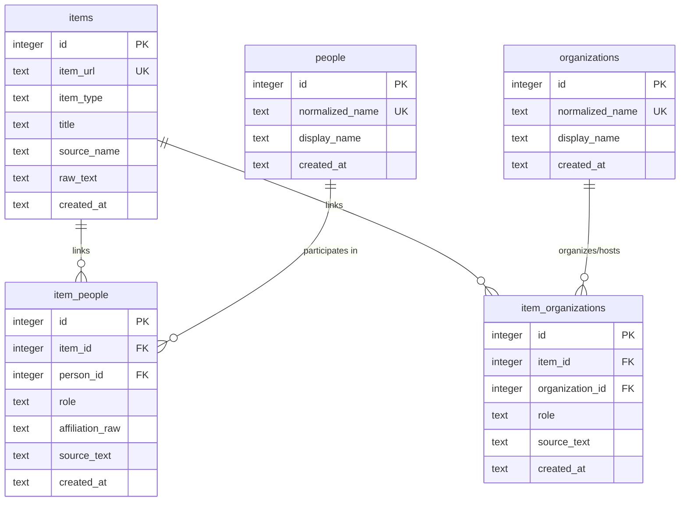

# Assignment 6 — Entity Storage and Relationships

## Overview

In previous assignments, entity extraction produced structured JSON records. However, storing entities solely embedded within a single JSON column prevents the system from querying connections across events over time (e.g. tracking a recurring speaker across multiple dates, or listing all events hosted by a specific institute center).

Assignment 6 introduces a relational SQLite model with dedicated entity tables (`people`, `organizations`) and many-to-many relationship tables (`item_people`, `item_organizations`), maintaining full provenance without duplicating entity profiles across event records.

---

## Relational Entity-Relationship Diagram



---

## SQLite DDL Schema

```sql
PRAGMA foreign_keys = ON;

-- 1. Core Event Items
CREATE TABLE IF NOT EXISTS items (
    id          INTEGER PRIMARY KEY AUTOINCREMENT,
    item_url    TEXT UNIQUE NOT NULL,
    item_type   TEXT DEFAULT 'event',
    title       TEXT,
    source_name TEXT,
    raw_text    TEXT,
    created_at  TEXT NOT NULL
);

-- 2. People Entity Table (Deduplicated canonical profiles)
CREATE TABLE IF NOT EXISTS people (
    id              INTEGER PRIMARY KEY AUTOINCREMENT,
    normalized_name TEXT UNIQUE NOT NULL,
    display_name    TEXT NOT NULL,
    created_at      TEXT NOT NULL
);

-- 3. Organizations Entity Table (Deduplicated canonical profiles)
CREATE TABLE IF NOT EXISTS organizations (
    id              INTEGER PRIMARY KEY AUTOINCREMENT,
    normalized_name TEXT UNIQUE NOT NULL,
    display_name    TEXT NOT NULL,
    created_at      TEXT NOT NULL
);

-- 4. Many-to-Many Join Table: Events <-> People
CREATE TABLE IF NOT EXISTS item_people (
    id              INTEGER PRIMARY KEY AUTOINCREMENT,
    item_id         INTEGER NOT NULL REFERENCES items(id) ON DELETE CASCADE,
    person_id       INTEGER NOT NULL REFERENCES people(id) ON DELETE CASCADE,
    role            TEXT NOT NULL,
    affiliation_raw TEXT,
    source_text     TEXT NOT NULL,
    created_at      TEXT NOT NULL,
    UNIQUE(item_id, person_id, role)
);

-- 5. Many-to-Many Join Table: Events <-> Organizations
CREATE TABLE IF NOT EXISTS item_organizations (
    id              INTEGER PRIMARY KEY AUTOINCREMENT,
    item_id         INTEGER NOT NULL REFERENCES items(id) ON DELETE CASCADE,
    organization_id INTEGER NOT NULL REFERENCES organizations(id) ON DELETE CASCADE,
    role            TEXT NOT NULL,
    source_text     TEXT NOT NULL,
    created_at      TEXT NOT NULL,
    UNIQUE(item_id, organization_id, role)
);

-- Fast lookup indexes
CREATE INDEX IF NOT EXISTS idx_item_people_person ON item_people(person_id);
CREATE INDEX IF NOT EXISTS idx_item_people_item   ON item_people(item_id);
CREATE INDEX IF NOT EXISTS idx_item_people_role   ON item_people(role);

CREATE INDEX IF NOT EXISTS idx_item_orgs_org      ON item_organizations(organization_id);
CREATE INDEX IF NOT EXISTS idx_item_orgs_item     ON item_organizations(item_id);
CREATE INDEX IF NOT EXISTS idx_item_orgs_role     ON item_organizations(role);
```

---

## Concepts & Architectural Rationale

### 1. Entity Table vs. Relationship (Join) Table
- **Entity Tables (`people`, `organizations`)**: Store the entity's intrinsic identity. A person exists independently of any single seminar. There is exactly one row per unique individual or organization.
- **Relationship Tables (`item_people`, `item_organizations`)**: Store the *contextual interaction* between an event and an entity. The role (`speaker`, `chair`, `organizer`), the event-specific affiliation (`affiliation_raw`), and the exact line of text that declared the relationship (`source_text`) belong on the join table, not on the entity record.

### 2. Many-to-Many Relationships
- One event can link to **multiple people** (keynote speaker, session chair, panelist, moderator) and **multiple organizations** (primary organizer, co-organizing department, sponsoring bank).
- The same person (e.g. `Prof. Arvind Sharma`) or organization (e.g. `Centre for Management in Agriculture`) appears across multiple distinct events without duplicating their canonical row.

### 3. Display Value vs. Normalized Matching Key
- **`display_name`**: Preserves raw formatting, original casing, and honorifics (e.g., `Prof. Arvind Sharma`, `Justice (Retd.) S. Muralidhar`).
- **`normalized_name`**: A lowercase, whitespace-trimmed, honorific-stripped key used as a `UNIQUE` constraint (e.g., `arvind sharma`).
  This allows:
  - `Prof. Arvind Sharma` and `Dr. Arvind Sharma` to cleanly resolve to the same person record `arvind sharma`.
  - While ensuring `Dr. Rajesh Kumar` (`rajesh kumar`) and `Prof. R. Kumar` (`r. kumar`) remain strictly distinct entities.

### 4. Conservative Entity Creation (No Over-Engineered Identity Resolution)
At this stage in the pipeline:
- We do **not** use fuzzy name distance, Levenshtein thresholds, or phonetic algorithms (Metaphone/Soundex) to guess that two slightly different names are the same person.
- Over-aggressive merging corrupts datasets irreversibly. Conservative matching preserves distinct entries until explicit external signals (such as ORCID or email) confirm identity.

### 5. Provenance on Relationships
Every row in `item_people` and `item_organizations` retains `source_text`. If an extraction question arises in the future, the exact raw line from the crawled document is permanently linked to the relational row.

---

## Required Queries & Sample Results

### Query 1: Which events in my local database mention this exact normalized person name?

#### SQL:
```sql
SELECT 
    i.id AS event_id,
    i.item_url,
    i.title AS event_title,
    p.display_name AS person_name,
    ip.role,
    ip.affiliation_raw,
    ip.source_text
FROM items i
JOIN item_people ip ON i.id = ip.item_id
JOIN people p       ON ip.person_id = p.id
WHERE p.normalized_name = 'arvind sharma'
ORDER BY i.id ASC;
```

#### Output on Sample Fixture:
```text
Event ID 2:  Annual Management Research Conference 2026
  Role:        speaker
  Affiliation: Indian Institute of Management Ahmedabad
  Source:      'Keynote Speaker: Prof. Arvind Sharma, Indian Institute of Management Ahmedabad'

Event ID 10: Global Macroeconomics Workshop
  Role:        speaker
  Affiliation: IIM Ahmedabad
  Source:      'Speakers: Prof. Arvind Sharma, IIM Ahmedabad; Dr. Sunita Rao, IISc Bangalore; Mr. Kevin Vance'
```

---

### Query 2: Which organizations have appeared as organizers in my collected sample?

#### SQL:
```sql
SELECT 
    o.id AS organization_id,
    o.display_name,
    o.normalized_name,
    io.role,
    COUNT(DISTINCT io.item_id) AS event_count,
    GROUP_CONCAT(DISTINCT i.title) AS event_titles
FROM organizations o
JOIN item_organizations io ON o.id = io.organization_id
JOIN items i               ON io.item_id = i.id
WHERE io.role = 'organizer'
GROUP BY o.id, o.display_name, o.normalized_name, io.role
ORDER BY event_count DESC, o.display_name ASC;
```

#### Output on Sample Fixture:
| Organization | Role | Event Count | Events |
|---|---|---|---|
| **Centre for Management in Agriculture** | organizer | 1 | Agricultural Credit and Smallholder Sustainability |
| **CIIE.CO** | organizer | 1 | Women in Tech and Venture Capital Roundtable |
| **Centre for Digital Transformation** | organizer | 1 | Digital Transformation in Public Distribution Systems |
| **Department of Example** | organizer | 1 | Decarbonization Pathways for Developing Economies |
| **Economics Area** | organizer | 1 | Global Macroeconomics Workshop |
| **Legal Studies Group** | organizer | 1 | Symposium on Constitutional Law and Democratic Institutions |
| **Ravi J. Matthai Centre for Educational Innovation** | organizer | 1 | Workshop on Behavioral Game Theory |
| **Research and Publications Office** | organizer | 1 | Annual Management Research Conference 2026 |
| **School of Public Policy and Governance** | organizer | 1 | Public Policy Lecture on Fiscal Federalism |

---

## Checkpoint Verification

> **Checkpoint**: You should not need to duplicate the full person record inside every event row.

Across our 18 sample events:
- **`items`**: 18 rows
- **`people`**: 35 rows
- **`item_people`**: 37 rows
- **`organizations`**: 14 rows
- **`item_organizations`**: 15 rows

Because individuals like `Arvind Sharma` and centers like `Centre for Management in Agriculture` participate across multiple events, `count(people) < count(item_people)`. The full profile data is stored exactly once; only lightweight foreign key references are maintained in the join tables.
