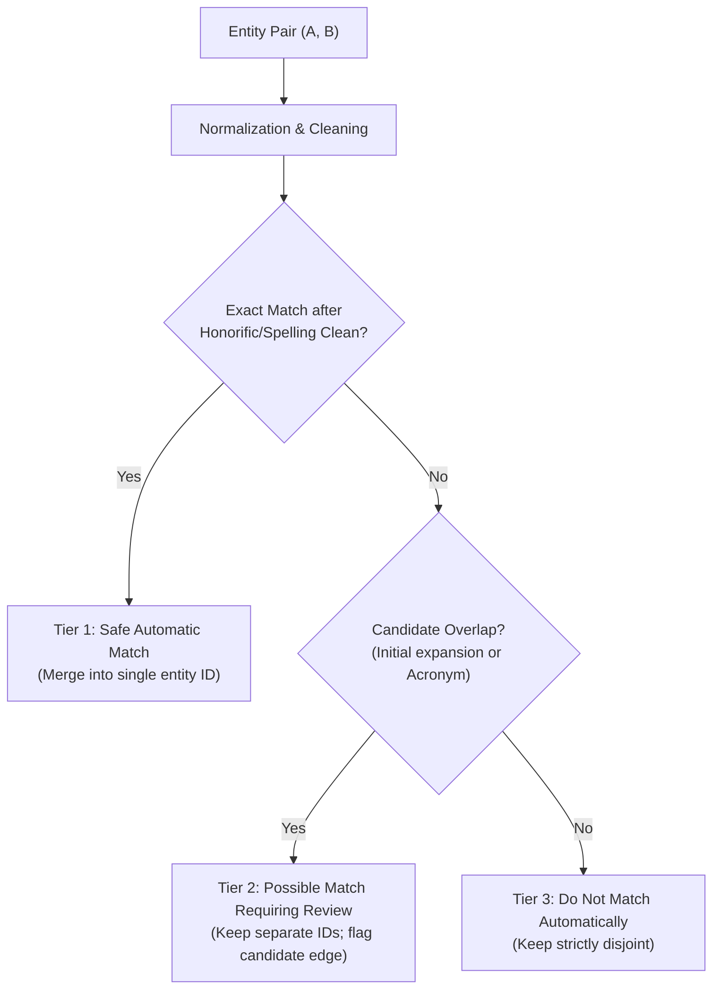

# Assignment 7 — Entity Matching Policy & Decision Matrix

## Executive Summary

When tracking entities (speakers, faculty, organizations) across an aggregator, strings vary due to honorifics, punctuation, initials, acronyms, and British vs. American spellings.

This document establishes the **Week 3 Entity Resolution Policy**. The foundational rule of this policy is:

> **Always favor a FALSE SPLIT over a FALSE MERGE when identity is uncertain.**

- **False Split (Conservative)**: Creating two separate records for the same real-world entity. This is safe, transparent, and can always be reconciled later when additional confirming evidence (e.g. affiliation, email, ORCID) is collected.
- **False Merge (Destructive)**: Merging two distinct individuals or organizations into a single database row because their names or initials look similar. This permanently corrupts data, attributes events to the wrong people, and is nearly impossible to automatically reverse.

---

## 1. Decision Matrix: Person Name Pairs

| # | Entity A | Entity B | Decision | Policy Rationale |
|---|---|---|---|---|
| **1** | `Prof. Ananya Rao` | `Ananya Rao` | **safe automatic match** | Stripping common academic honorific (`Prof.`) leaves identical full names (`ananya rao`). No entity collision risk. |
| **2** | `Prof. Ananya Rao` | `Prof Ananya Rao` | **safe automatic match** | Punctuation-only variation (period after honorific). Both tokenize to the exact same name. |
| **3** | `Ananya Rao` | `Prof Ananya Rao` | **safe automatic match** | Honorific removal produces exact full name match (`ananya rao`). |
| **4** | `Prof. Ananya Rao` | `A. Rao` | **possible match requiring review** | Initial-only first name (`A.`). Could refer to *Arvind Rao*, *Amit Rao*, or *Ananya Rao*. Auto-merging risks severe false merge. Flagged for review with institutional context. |
| **5** | `Ananya Rao` | `A. Rao` | **possible match requiring review** | Same initial ambiguity as above. Weak similarity must never trigger automatic database unification. |
| **6** | `Prof. Ananya Rao` | `Ananya R.` | **possible match requiring review** | Truncated surname initial (`R.`). Could be *Ananya Roy*, *Ananya Reddy*, or *Ananya Rao*. Requires departmental/affiliation confirmation. |
| **7** | `Ananya Rao` | `Ananya R.` | **possible match requiring review** | Same surname initial ambiguity. Must not auto-merge without corroborating evidence. |
| **8** | `A. Rao` | `Ananya R.` | **do not match automatically** | Both tokens are truncated (initial + surname vs. first name + initial). Mutual information is too weak to suggest even a candidate match. |
| **9** | `Dr. Rajesh Kumar` | `Prof. R. Kumar` | **possible match requiring review** | Initial match on common surname (`Kumar`). High risk of distinct people (e.g. *Ramesh Kumar*, *Rakesh Kumar*). Must remain split until confirmed. |
| **10** | `Ananya Rao` | `Ananya Sharma` | **do not match automatically** | Distinct surnames. Clearly different individuals. |

---

## 2. Decision Matrix: Organization Pairs

| # | Entity A | Entity B | Decision | Policy Rationale |
|---|---|---|---|---|
| **1** | `Centre for Policy Research` | `Center for Policy Research` | **safe automatic match** | Standard British vs. American English spelling variation (`Centre` vs. `Center`). Semantically and lexically identical. |
| **2** | `Centre for Policy Research` | `Centre for Policy Research (CPR)` | **safe automatic match** | Parenthetical acronym extension. Stripping `(CPR)` yields the exact canonical organization string. |
| **3** | `Centre for Policy Research` | `CPR` | **possible match requiring review** | Standalone acronyms are highly ambiguous. `CPR` could be *Cardiopulmonary Resuscitation*, *Coalition for Peace and Reconciliation*, or *Centre for Policy Research*. Requires source context. |
| **4** | `Center for Policy Research` | `CPR` | **possible match requiring review** | Same acronym collision risk as above with American spelling variant. Flag for human/context review. |
| **5** | `Indian Institute of Management Ahmedabad` | `IIM Ahmedabad` | **safe automatic match** | Standard institutional abbreviation (`Indian Institute of Management` -> `IIM`) accompanied by the exact distinctive geographic qualifier (`Ahmedabad`). |
| **6** | `Indian Institute of Management Ahmedabad` | `IIMA` | **possible match requiring review** | Single 4-letter acronym. While well-known in context, raw acronyms without geographic qualifiers must be reviewed against domain origin before permanent merge. |
| **7** | `Centre for Management in Agriculture` | `Centre for ESG Research` | **do not match automatically** | Distinct specialized research centers under the same institute. Must never be merged. |
| **8** | `School of Public Policy` | `School of Public Health` | **do not match automatically** | High prefix overlap (`School of Public...`), but completely different academic disciplines (`Policy` vs. `Health`). Definite non-match. |

---

## 3. The Week 3 Matching Policy Framework

We define a **Three-Tiered Resolution Pipeline**:

### Tier 1: Safe Automatic Match
- **Criteria**:
  - Exact match after stripping recognized honorific prefixes (`Dr.`, `Prof.`, `Smt.`, `Shri`, etc.).
  - Exact match after stripping trailing punctuation and whitespace.
  - Known regional spelling equivalence (e.g. `Centre` <-> `Center`).
  - Removal of explicit parenthetical acronyms (e.g. `Foo Bar (FB)` <-> `Foo Bar`).
  - Well-defined institutional abbreviations accompanied by identical distinctive qualifiers (e.g. `Indian Institute of Management Ahmedabad` <-> `IIM Ahmedabad`).
- **Database Action**: Resolve to a single `person_id` or `organization_id`.

### Tier 2: Possible Match Requiring Review
- **Criteria**:
  - Full name vs. Initial expansion (e.g. `Ananya Rao` vs. `A. Rao` or `Ananya R.`).
  - Standalone acronym vs. Full organization title (e.g. `CPR` vs. `Centre for Policy Research`).
  - Token overlap with missing secondary qualifiers.
- **Database Action**:
  - **Do NOT auto-merge.**
  - Maintain two separate rows in `people` or `organizations`.
  - Log a candidate edge in a review queue table with confidence notes and source context.

### Tier 3: Do Not Match Automatically
- **Criteria**:
  - Conflicting surnames or conflicting first names.
  - Double truncation (`A. Rao` vs. `Ananya R.`).
  - Different academic departments or distinct centers sharing parent institute words.
- **Database Action**: Reject immediately. Treat as completely independent entities.

---

## 4. Checkpoint Verification

> **Checkpoint**: Your code should not turn a weak similarity score into an authoritative identity claim.

In [test_entity_matching.py](file:///c:/Users/Saanvi/Documents/SAANVI/SSRISS_ASSIGNMENTS-1/Week_3/assignments/07_resolution/test_entity_matching.py), test class `TestCheckpointWeakSimilarity` asserts:
1. `A. Rao` vs. `Ananya Rao` produces `POSSIBLE_MATCH_REQUIRING_REVIEW`, never `SAFE_AUTOMATIC_MATCH`.
2. `Ananya R.` vs. `Ananya Rao` produces `POSSIBLE_MATCH_REQUIRING_REVIEW`, never `SAFE_AUTOMATIC_MATCH`.
3. `CPR` vs. `Centre for Policy Research` produces `POSSIBLE_MATCH_REQUIRING_REVIEW`, never `SAFE_AUTOMATIC_MATCH`.
4. `A. Rao` vs. `Ananya R.` produces `DO_NOT_MATCH_AUTOMATICALLY`.

Weak or ambiguous similarities remain in a pending/review state and never corrupt the primary entity tables.
