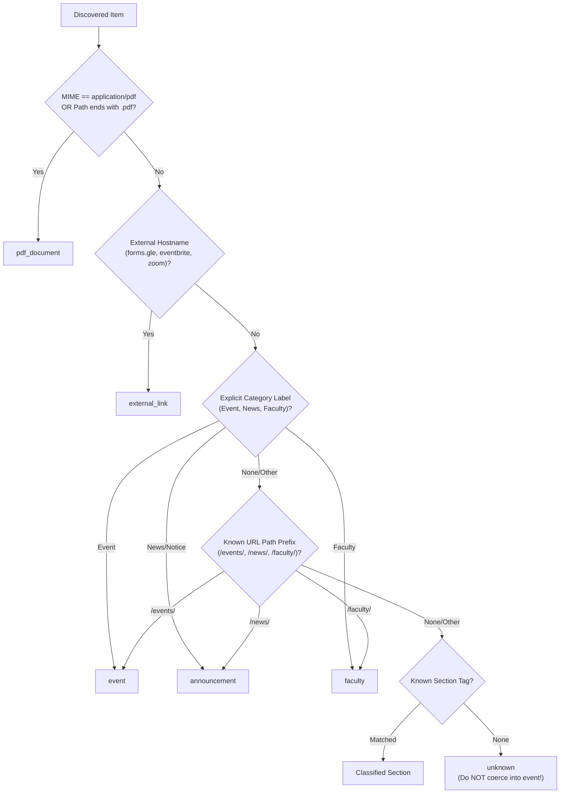

# Assignment 8 — Multi-Content Central Aggregators & Content Router

## Overview

Central institutional aggregators (such as university or research institute homepages) rarely publish only a single uniform content type. Instead, their listings and feeds interleave:
- **Events** (conferences, webinars, colloquia, workshops)
- **Announcements & News** (press releases, tender notices, appointments)
- **Faculty Profiles** (directory pages, scholar biographies)
- **PDF Documents** (conference agendas, annual reports, whitepapers)
- **External Links** (Google Forms registrations, Eventbrite ticket pages, Zoom meetings)
- **Unsupported / Unknown Pages** (photo galleries, search result pages, working paper repositories)

Assignment 8 introduces a **structural routing layer** (`classify_discovered_item`) that inspects discovery metadata and dispatches records to content-appropriate parsers while preserving unsupported items rather than forcing them into the event schema or dropping them.

---

## 1. Classification Types & Routing Targets

| Content Type | Structural Evidence | Target Parser | Support Status |
|---|---|---|---|
| **`event`** | Path contains `/events/`, `/seminar/`, `/webinar/`; or Category in `{"Event", "Seminar", "Webinar"}` | `event_detail_parser` | **Supported** |
| **`announcement`** | Path contains `/news/`, `/announcements/`, `/press-release/`, `/tenders/`; or Category in `{"News", "Notice"}` | `announcement_parser` | **Supported** |
| **`faculty`** | Path contains `/faculty-research/faculty/`, `/people/faculty/`; or Category `"Faculty Directory"` | `faculty_profile_parser` | **Supported** |
| **`pdf_document`** | MIME type is `application/pdf`; or URL ends with `.pdf` | `pdf_metadata_extractor` | **Deferred** (Binary pipeline) |
| **`external_link`** | Host is outside allowed domain (e.g. `forms.gle`, `eventbrite.com`, `zoom.us`) | `external_link_recorder` | **Deferred** (Out of crawl scope) |
| **`unknown`** | Ambiguous, unsupported section (galleries, search URLs, custom taxonomies) | `unsupported_item_handler` | **Unsupported** (Preserved in DB) |

---

## 2. Structural Evidence Hierarchy

### Precedence Rules:
1. **MIME/Binary Sniffing**: If an item is a binary PDF, it cannot be processed by an HTML parser regardless of whether its title says "Conference Agenda". It routes directly to `pdf_document`.
2. **Domain Boundary (Scope Control)**: If a registration link points to `forms.gle` or `eventbrite.com`, it must not enter the local detail-page extractor. It is classified as `external_link`.
3. **Explicit Metadata Over Path Heuristics**: If the publisher explicitly flags `Category: Seminar`, this takes precedence over generic URL paths.
4. **URL Path Structure**: Well-defined institutional prefixes (`/the-institute/events/`, `/news/`, `/faculty-research/faculty/`) provide secondary deterministic classification.
5. **No Topic/Narrative Interpretation**: Content is **never** classified based on political or narrative keywords. A news story titled *"Panel Debate on Electoral Policy"* remains an `announcement` because its structural path is `/news/`, and is not converted into an `event`.
6. **Conservative Fallback (`unknown`)**: If no structural evidence matches, the item is tagged as `unknown`.

---

## 3. Checkpoint Verification

> **Checkpoint**: An unsupported item should be recorded as unsupported/unknown rather than silently disappearing or being forced into the wrong schema.

In our 18-record sample test fixture ([mixed_listing_sample.json](file:///c:/Users/Saanvi/Documents/SAANVI/SSRISS_ASSIGNMENTS-1/Week_3/assignments/08_routing/fixtures/mixed_listing_sample.json)):
- 4 items represent unsupported or non-event content:
  - `item_15`: Autumn Campus Life Photo Gallery (`/campus-life/photo-gallery-autumn-2026`)
  - `item_16`: Raw search query page (`/search?q=management+education`)
  - `item_17`: Working paper publication page (`/research/working-papers/wp-2026-08`)
  - `item_18`: Virtual campus tour (`/about/virtual-campus-tour`)

### Verification Guarantees:
1. **Not Silently Dropped**: In [content_router.py](file:///c:/Users/Saanvi/Documents/SAANVI/SSRISS_ASSIGNMENTS-1/Week_3/assignments/08_routing/content_router.py#L182), [route_discovered_item](file:///c:/Users/Saanvi/Documents/SAANVI/SSRISS_ASSIGNMENTS-1/Week_3/assignments/08_routing/content_router.py#L182) returns a `RoutedItem` retaining the complete `raw_record` and assigns it to `unsupported_item_handler`.
2. **Not Coerced into Event**: None of these four items are labeled `event`. In [test_content_router.py](file:///c:/Users/Saanvi/Documents/SAANVI/SSRISS_ASSIGNMENTS-1/Week_3/assignments/08_routing/test_content_router.py#L93), test `test_checkpoint_unsupported_not_forced_into_event` asserts all four return `ItemType.UNKNOWN.value`.
