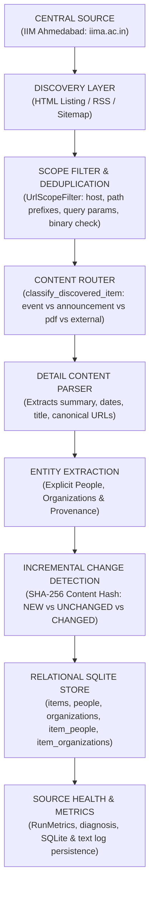

# Assignment 10 — Central Aggregator Implementation & Architecture

## Overview

Assignment 10 synthesizes all capabilities built across Week 3 into a single, cohesive **Central Aggregator Adapter** ([central_aggregator_adapter.py](file:///c:/Users/Saanvi/Documents/SAANVI/SSRISS_ASSIGNMENTS-1/Week_3/assignments/10_adapter/central_aggregator_adapter.py)). The pipeline handles the complete lifecycle from central multi-channel discovery to relational SQLite persistence and operational health monitoring.

---

## 1. End-to-End Architectural Pipeline



---

## 2. Controlled Crawl Ceiling

In accordance with Assignment 10 guidelines:
> *"For the assignment, keep the live crawl controlled. Suggested ceiling: 2–5 listing/archive pages or 20–40 discovered item records. The purpose is to prove architecture, not scrape an entire archive."*

The adapter implements explicit ceiling controls in [DEFAULT_IIMA_CONFIG](file:///c:/Users/Saanvi/Documents/SAANVI/SSRISS_ASSIGNMENTS-1/Week_3/assignments/10_adapter/central_aggregator_adapter.py#L46):

```python
{
    "source_name":            "iima_events",
    "allowed_hostname":       "www.iima.ac.in",
    "allowed_path_prefixes":  ["/the-institute/events", "/news"],
    "excluded_path_prefixes": ["/login", "/search", "/calendar", "/filter", "/sites/default/files"],
    "allow_external":         False,
    "max_items":              30,      # Ceiling: 20–40 records
    "max_pages":              3,       # Ceiling: 2–5 pages
    "ignored_query_params":   ["utm_source", "utm_medium", "utm_campaign", "fbclid", "gclid"],
}
```

The scope filter bounds candidate URLs before detail extraction, preventing calendar explosions, search queries, and binary file downloads from consuming pipeline resources.

---

## 3. Real Execution Walkthrough & Results

Tested against the central listing fixture ([central_listing.html](file:///c:/Users/Saanvi/Documents/SAANVI/SSRISS_ASSIGNMENTS-1/Week_3/assignments/10_adapter/fixtures/central_listing.html)):

### Run 1: Initial Central Ingestion
```text
SOURCE: iima_events
PAGES_FETCHED: 1
ITEMS_DISCOVERED: 16
ITEMS_PARSED: 16
NEW: 16
CHANGED: 0
UNCHANGED: 0
FAILED: 0
PEOPLE_EXTRACTED: 22
ORGANIZATIONS_EXTRACTED: 13
PCT_WITH_DATE: 100.0%
PCT_WITH_SPEAKER: 100.0%
PCT_WITH_ORGANIZATION: 81.2%
STATUS: HEALTHY: New or changed content collected
DIAGNOSIS: Healthy: Processed 16 new and 0 updated items.
```

### Run 2: Incremental Re-crawl (Steady State Verification)
```text
SOURCE: iima_events
PAGES_FETCHED: 1
ITEMS_DISCOVERED: 16
ITEMS_PARSED: 16
NEW: 0
CHANGED: 0
UNCHANGED: 16
FAILED: 0
PEOPLE_EXTRACTED: 22
ORGANIZATIONS_EXTRACTED: 13
PCT_WITH_DATE: 100.0%
PCT_WITH_SPEAKER: 100.0%
PCT_WITH_ORGANIZATION: 81.2%
STATUS: HEALTHY: Source had no new content (all unchanged)
DIAGNOSIS: Healthy: Source active (16 items visible); no new or updated items since previous run.
```

### Relational Store Output:
```text
Total Stored Items:         16
Total Unique People:        20
Total Unique Organizations: 12
Event-People Links:         22
Event-Org Links:            13
```

---

## 4. Key Verification Guarantees

| Capability | Implementation Mechanism | Verified In Test Suite |
|---|---|---|
| **High-yield central surface** | Target `www.iima.ac.in` covering multiple centers, schools, and conferences in one discovery stream | [test_central_aggregator.py](file:///c:/Users/Saanvi/Documents/SAANVI/SSRISS_ASSIGNMENTS-1/Week_3/assignments/10_adapter/test_central_aggregator.py#L30) |
| **Bounded scope** | Hostname allowlist + prefix allowlist/blocklist (`/login`, `/sites/default/files` rejected) | [test_scope_filters_out_login_pdf_and_external](file:///c:/Users/Saanvi/Documents/SAANVI/SSRISS_ASSIGNMENTS-1/Week_3/assignments/10_adapter/test_central_aggregator.py#L34) |
| **Deduplication** | Tracking parameters (`utm_source`, etc.) stripped; canonical URLs matched against visited set | [test_scope_filters_out_login_pdf_and_external](file:///c:/Users/Saanvi/Documents/SAANVI/SSRISS_ASSIGNMENTS-1/Week_3/assignments/10_adapter/test_central_aggregator.py#L34) |
| **Incremental behavior** | SHA-256 stable content hashes distinguish `NEW` (16 on run 1) vs `UNCHANGED` (16 on run 2) | [test_two_consecutive_runs_steady_state](file:///c:/Users/Saanvi/Documents/SAANVI/SSRISS_ASSIGNMENTS-1/Week_3/assignments/10_adapter/test_central_aggregator.py#L105) |
| **Explicit entity extraction** | Pattern-driven extraction of `Speaker:`, `Chair:`, `Organized by:` with `source_text` provenance | [test_people_and_org_extraction_counts](file:///c:/Users/Saanvi/Documents/SAANVI/SSRISS_ASSIGNMENTS-1/Week_3/assignments/10_adapter/test_central_aggregator.py#L66) |
| **Relational links** | Many-to-many join tables (`item_people`, `item_organizations`); deduplicated canonical profiles | [test_relational_entity_deduplication](file:///c:/Users/Saanvi/Documents/SAANVI/SSRISS_ASSIGNMENTS-1/Week_3/assignments/10_adapter/test_central_aggregator.py#L77) |
| **Run summary & logs** | Structured key-value summary metrics persisted to SQLite `run_metrics` and text logs | [test_persistence_to_sqlite_and_log](file:///c:/Users/Saanvi/Documents/SAANVI/SSRISS_ASSIGNMENTS-1/Week_3/assignments/10_adapter/test_central_aggregator.py#L143) |
